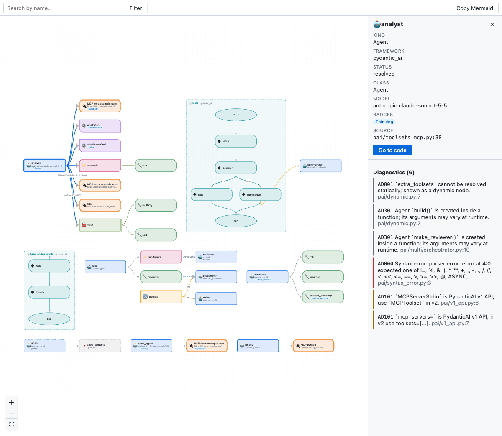

# agentsdiagram

**See your AI agents.** `agentsdiagram` reads the code of your [PydanticAI](https://ai.pydantic.dev)
and [smolagents](https://huggingface.co/docs/smolagents) agents and draws them: agents, tools,
toolsets, MCP servers, capabilities, delegation between agents, hand-off workflows and
pydantic-graph flows.

It is **static analysis**: your code is parsed, never imported or executed. No API keys, no
dependencies of your project, no network.



- **CLI**: Mermaid, JSON or a self-contained interactive HTML page.
- **VS Code extension** (also on Open VSX for Cursor, Windsurf and Positron): a live diagram next to
  your code that follows your edits, "Show in diagram" code lenses and diagnostics.

## Quick start

```bash
uvx agentsdiagram scan path/to/project                    # Mermaid to stdout
uvx agentsdiagram scan . -f html -o agents.html           # interactive page, open it in any browser
uvx agentsdiagram scan . -f markdown -o AGENTS-DIAGRAM.md # renders on GitHub
uvx agentsdiagram check .                                 # diagnostics; exit 1 on errors (CI, pre-commit)
```

Or install it: `uv tool install agentsdiagram` / `pip install agentsdiagram`.

```
agentsdiagram scan [PATH] [-f mermaid|json|html|markdown] [-o FILE] [--framework pydantic_ai|smolagents]
                   [--include GLOB] [--exclude GLOB] [--title TEXT]
agentsdiagram check [PATH] [--strict] [--json]
agentsdiagram schema        # JSON Schema of the IR
agentsdiagram lsp           # language server (needs agentsdiagram[lsp]); used by the extension
```

Project-wide settings go in `pyproject.toml`:

```toml
[tool.agentsdiagram]
include = ["src/**"]
exclude = ["tests/**", "notebooks/**"]
```

## What it understands

| | PydanticAI 2.x | smolagents 1.x |
|---|---|---|
| Agents | `Agent(...)`, `Agent.from_file("spec.yaml")`, factories (`make_agent()`) | `CodeAgent`, `ToolCallingAgent` |
| Tools | `@agent.tool`, `@agent.tool_plain`, `tools=[f, Tool(...)]` | `@tool`, `Tool` subclasses, default tools, `add_base_tools` |
| Toolsets | `FunctionToolset`, wrappers (`.prefixed()`, `.filtered()`…), `@agent.toolset` | `ToolCollection`, Hub/Space/LangChain sources |
| MCP | `MCPToolset(...)`, `load_mcp_toolsets("mcp.json")`, `MCP(url=...)` | `ToolCollection.from_mcp`, `MCPClient` |
| Multi-agent | agent run inside a tool, `SubAgents`, hand-off functions | `managed_agents=[...]` |
| Flows | pydantic-graph `GraphBuilder` (steps, decisions, joins) and `BaseNode` | — |
| Checks | v1 API still in use | managed agents without name/description, `@tool` without hints, name clashes |

Anything that only exists at runtime (lists built in a loop, tools fetched from a server) shows up
as a dashed **dynamic** node instead of silently disappearing. Full coverage matrices:
[PydanticAI](docs/adapters/pydantic_ai.md) · [smolagents](docs/adapters/smolagents.md).

## VS Code extension

Install **Agents Diagram** from the Marketplace or Open VSX. It needs either
[uv](https://docs.astral.sh/uv/) (the extension runs `uvx agentsdiagram[lsp]`) or your own command
in `agentsdiagram.server.command`. The Python extension is not required. See
[packages/vscode/README.md](packages/vscode/README.md).

## How it works

```
your code ──LibCST──▶ adapters (pydantic_ai, smolagents) ──▶ facts ──link──▶ IR (JSON)
                                                                         ├─▶ Mermaid
                                                                         ├─▶ HTML viewer (React Flow)
                                                                         └─▶ LSP ─▶ VS Code panel
```

The IR is a small, versioned JSON format ([docs/ir.md](docs/ir.md)); the viewer and the
extension use TypeScript types generated from its JSON Schema. Architecture and design
decisions: [docs/architecture.md](docs/architecture.md).

## Roadmap

- **Plan** (v0.3): draw agents and tools that do not exist yet; agentsdiagram writes the stubs.
- **Edit** (v0.4): connect, add and remove tools and agents in the diagram; the change is written
  to your code with LibCST, preserving formatting. The code stays the single source of truth.
- More frameworks through adapters ([docs/adding-a-framework.md](docs/adding-a-framework.md)).

## Development

```bash
uv sync                      # Python 3.11+, includes pydantic-ai and smolagents for the oracle tests
pnpm install && pnpm build   # viewer + extension (pnpm 11, Node 22+)
uv run pytest                # unit, snapshot, oracle, drift and LSP tests
pnpm test                    # viewer (vitest) + extension smoke test
```

More in [docs/architecture.md](docs/architecture.md#development) and [docs/releasing.md](docs/releasing.md).

## License

MIT © 2026 Alex Ojeda Copa
