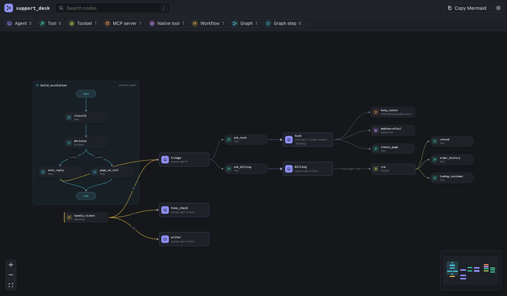
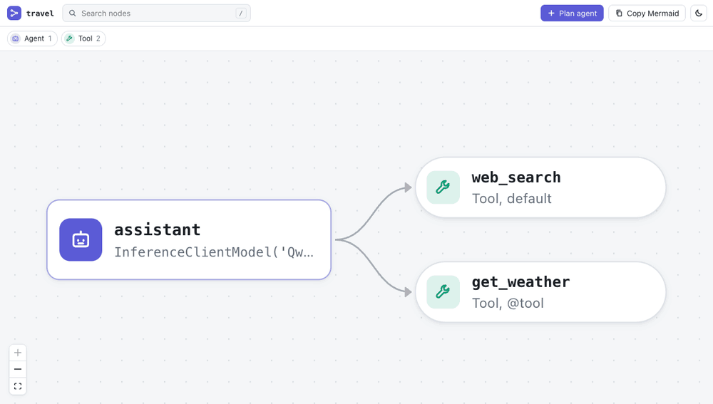

# agentsdiagram

[](https://pypi.org/project/agentsdiagram/)
[](https://marketplace.visualstudio.com/items?itemName=alex-roc.agentsdiagram)
[](https://open-vsx.org/extension/alex-roc/agentsdiagram)
[](https://github.com/alex-roc/agentsdiagram/actions/workflows/ci.yml)
[](LICENSE)

**See, plan and edit your AI agents.** `agentsdiagram` reads the code of your
[smolagents](https://huggingface.co/docs/smolagents) and [PydanticAI](https://ai.pydantic.dev)
agents and draws them: agents, tools, MCP servers, managed agents and delegation, hand-off
workflows and pydantic-graph flows. Then it lets you change them from the diagram: plan agents and
tools that do not exist yet, connect agents, swap models. Every change is written to your code.

It is **static analysis**: your code is parsed, never imported or executed. No API keys, no
dependencies of your project, no network.


<details><summary>Dark theme</summary>



</details>

**Website, tutorials and live demos:** <https://alex-roc.github.io/agentsdiagram/>

## Quick start

```bash
uvx agentsdiagram scan . -f html -o agents.html   # an interactive page, open it in any browser
uvx agentsdiagram serve                           # the same, live and editable, at http://127.0.0.1:8765
uvx agentsdiagram check .                         # diagnostics; exit 1 on errors (CI, pre-commit)
```

Or install it: `uv tool install agentsdiagram` / `pip install agentsdiagram` (Python 3.11+).
In your editor: the **Agents Diagram** extension for
[VS Code](https://marketplace.visualstudio.com/items?itemName=alex-roc.agentsdiagram) and
[Open VSX](https://open-vsx.org/extension/alex-roc/agentsdiagram) (Cursor, Windsurf, Positron).

## See

```python
from smolagents import CodeAgent, InferenceClientModel, WebSearchTool, tool


@tool
def get_weather(city: str) -> str:
    """Current weather for a city.

    Args:
        city: Name of the city.
    """
    return "sunny"


assistant = CodeAgent(tools=[get_weather, WebSearchTool()], model=InferenceClientModel())
```

`agentsdiagram scan` turns that into a diagram with the agent, its model and its two tools, and
it scales to teams: managers and managed agents, agents that delegate to agents inside tools, MCP
servers, toolsets and their wrappers, workflows that run agents in order, pydantic-graph flows.
Click a node for its details and "Go to code"; `/` searches; the legend filters. Anything that
only exists at runtime shows up as a dashed **dynamic** node instead of silently disappearing.

`agentsdiagram check` catches mistakes the libraries only report at runtime, if at all: a smolagents
managed agent without a description, a `@tool` without type hints, two tools with the same name,
PydanticAI v1 API.

## Plan



Sketch a system before writing it. **Plan agent** in the diagram, or `agentsdiagram edit add-agent`,
writes a planned agent; **Add tool** writes a typed stub that raises
`NotImplementedError("agentsdiagram: planned")`. The plan is real, importable code, drawn with a
dashed outline until you implement it, and `agentsdiagram check` lists what is left to do.

```bash
agentsdiagram edit add-agent booker --parent assistant --description "Finds and books flights."
agentsdiagram edit add-tool booker search_flights --params "origin: str, destination: str, date: str"
agentsdiagram edit add-mcp booker --url https://maps.example.com/mcp
```

## Edit

Connect agents (`managed_agents` in smolagents, a delegation tool in PydanticAI), add MCP servers,
change models and instructions, disconnect and remove, or move a PydanticAI agent's settings to an
Agent Spec. Changes are made with LibCST, so the rest of the file keeps its formatting, imports
are added where they belong, and in VS Code every change can be undone. The code stays the only
source of truth: there is no project file and nothing to sync. [How it works](docs/editing.md).

## What it understands

| | smolagents 1.x | PydanticAI 2.x |
|---|---|---|
| Agents | `CodeAgent`, `ToolCallingAgent` | `Agent(...)`, `Agent.from_file("spec.yaml")`, factories (`make_agent()`) |
| Tools | `@tool`, `Tool` subclasses, default tools, `add_base_tools` | `@agent.tool`, `@agent.tool_plain`, `tools=[f, Tool(...)]` |
| Toolsets | `ToolCollection`, Hub/Space/LangChain sources | `FunctionToolset`, wrappers (`.prefixed()`, `.filtered()`…), `@agent.toolset` |
| MCP | `ToolCollection.from_mcp`, `MCPClient` | `MCPToolset(...)`, `load_mcp_toolsets("mcp.json")`, `MCP(url=...)` |
| Multi-agent | `managed_agents=[...]` | agent run inside a tool, `SubAgents`, hand-off functions |
| Flows | — | pydantic-graph `GraphBuilder` (steps, decisions, joins) and `BaseNode` |
| Checks | managed agents without name/description, `@tool` without hints, name clashes | v1 API still in use |
| Plan and edit | agents, `@tool` stubs, `MCPClient`, `managed_agents`, models | agents, `@agent.tool_plain` stubs, `MCPToolset`, delegation tools, models, Agent Specs |

Full coverage: [smolagents](docs/adapters/smolagents.md) · [PydanticAI](docs/adapters/pydantic_ai.md).

## Learn

- [Getting started](docs/getting-started.md)
- Tutorials: [1. One smolagents agent](docs/tutorials/01-one-smolagents-agent.md) ·
  [2. One PydanticAI agent](docs/tutorials/02-one-pydantic-ai-agent.md) ·
  [3. Teams of agents](docs/tutorials/03-teams-of-agents.md) ·
  [4. Plan before you code](docs/tutorials/04-plan-before-you-code.md) ·
  [5. Edit from the diagram](docs/tutorials/05-edit-from-the-diagram.md) ·
  [6. Diagrams in CI and docs](docs/tutorials/06-ci-and-docs.md) ·
  [7. With coding agents](docs/tutorials/07-coding-agents.md)
- Guides: [command line](docs/cli.md) · [plan and edit](docs/editing.md) · [VS Code extension](docs/vscode.md)
- Examples, from one agent to a team: [`examples/`](examples/)

## How it works

```
your code ──LibCST──▶ adapters (smolagents, pydantic_ai) ──▶ IR (JSON) ─┬─▶ Mermaid / Markdown
    ▲                                                                   ├─▶ HTML viewer (React Flow)
    │                                                                   ├─▶ serve (live, editable)
    └──────────── edits (LibCST, minimal diffs) ◀── edit protocol ◀─────┴─▶ LSP ─▶ VS Code panel
```

The IR is a small, versioned JSON format ([docs/ir.md](docs/ir.md)); the viewer and the
extension use TypeScript types generated from its JSON Schema. Architecture and design
decisions: [docs/architecture.md](docs/architecture.md).

## Roadmap

- More frameworks through adapters ([docs/adding-a-framework.md](docs/adding-a-framework.md)):
  OpenAI Agents, Google ADK, Agno, Strands, LangGraph.
- Keep a hand-arranged layout (`.agentsdiagram/layout.json`, matched by kind, file and name).
- Import and export smolagents `agent.json`.

## Development

```bash
uv sync                      # Python 3.11+, includes pydantic-ai and smolagents for the oracle tests
pnpm install && pnpm build   # viewer + extension (pnpm 11, Node 22+)
uv run pytest                # unit, snapshot, oracle, drift, edit, serve and LSP tests
pnpm test                    # viewer (vitest) + extension smoke test
```

More in [docs/architecture.md](docs/architecture.md#development) and [docs/releasing.md](docs/releasing.md).

## License

MIT © 2026 Alex Ojeda Copa
